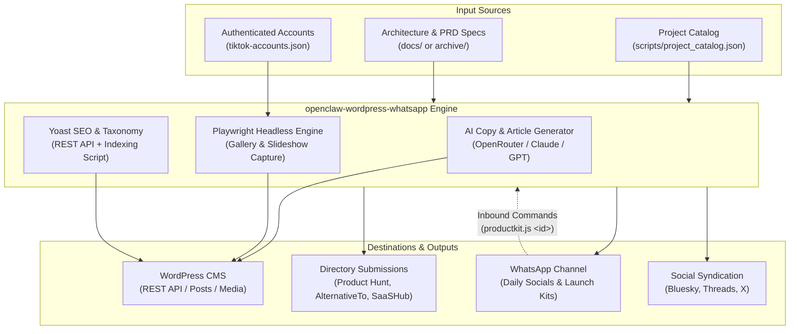

# openclaw-wordpress-whatsapp

> Autonomous publishing, directory launch kit, and social syndication engine integrating **WordPress REST API**, **Product Hunt directory submissions**, and **WhatsApp notifications & command triggers**.

---

## 🌟 Overview

**openclaw-wordpress-whatsapp** is a full-stack automation suite designed for developers and product builders using [OpenClaw](https://openclaw.ai). It turns local and hosted services, containerized apps, and project PRDs into:

1. **High-Ranking SEO Technical Guides on WordPress**: Automatically authored 1,200–1,800 word articles published via WordPress REST API with automated Yoast SEO metadata, schema markup, and headless Playwright screenshot media uploads.
2. **Product Hunt & Directory Launch Kits**: Instant, schema-compliant submission copy for **Product Hunt**, **AlternativeTo**, **SaaSHub**, **BetaList**, **There's An AI For That**, **Futurepedia**, **DevHunt**, and **Peerlist**, paired with a 3-image screenshot gallery (Desktop Hero, Feature View, Mobile Responsive).
3. **WhatsApp Notification & Command Center**: Automated delivery of daily social drafts and launch kits directly to your WhatsApp via the OpenClaw WhatsApp channel. Supports interactive command replies (e.g. `productkit.js <project-id>`) to trigger on-demand generation from your phone.
4. **TikTok & Mobile Video Slideshow Engine**: 9:16 mobile frame captures with optional authenticated user sign-in and AI-crafted storyboard narrations.

---

## 🏗️ Architecture Flow



---

## 📁 Repository Structure

```
openclaw-wordpress-whatsapp/
├── cli/
│   └── productkit.js               # CLI wrapper for on-demand launch kits
├── docs/
│   ├── WordPress_Automation_Architecture.md
│   ├── WordPress_Automation_PRD.md
│   ├── WhatsApp_API_Channel_Architecture.md
│   └── WhatsApp_API_Channel_PRD.md
├── mu-plugins/
│   └── yoast-meta-rest.php         # WordPress MU-Plugin exposing Yoast REST fields
├── plugins/
│   └── productkit/                 # OpenClaw tool plugin & WhatsApp command handler
│       ├── openclaw.plugin.json
│       ├── package.json
│       └── index.js
├── scripts/
│   ├── wp-cli.js                   # Headless WordPress REST API CLI (CRUD)
│   ├── generate-articles.js        # AI SEO article generation & publishing engine
│   ├── daily-social-post.js        # Daily social media post generator & WhatsApp dispatcher
│   ├── project-launch-kit.js       # Product Hunt & directory submission generator
│   ├── project-gallery-capture.js  # 3-screenshot gallery capture (Playwright)
│   ├── tiktok-slideshow-capture.js # 9:16 mobile slideshow capture & sign-in engine
│   ├── web-screenshot-capture.js   # Single-page featured image capture
│   ├── resave-yoast-posts.php      # Server-side Yoast indexable recalculation
│   ├── cron-auto-publish.sh        # Scheduled batch article publisher
│   ├── cron-daily-social.sh        # Scheduled daily social dispatcher
│   ├── project-capture-targets.json# Target selectors & deep-link URLs
│   ├── project_catalog.example.json# Template for catalog project definitions
│   └── tiktok-accounts.example.json# Template for automated web sign-ins
├── ecosystem.config.js             # PM2 process runner configuration
├── package.json                    # Node.js dependencies and script shortcuts
├── .env.example                    # Environment variable template
└── .gitignore                      # Strict ignore rules preventing credential leaks
```

---

## 🚀 Getting Started

### 1. Prerequisites

- **Node.js**: v18.0.0 or higher
- **WordPress**: With REST API enabled and an [Application Password](https://make.wordpress.org/core/2020/11/05/application-passwords-integration-guide/) created.
- **OpenRouter API Key**: For AI content generation (Claude 3.5 Sonnet, GPT-4o, etc.).
- **OpenClaw CLI**: Connected with the WhatsApp gateway channel.
- **Chromium / Playwright**: For browser screenshots.

### 2. Installation

Clone this repository and install dependencies:

```bash
git clone https://github.com/thirza258/openclaw-wordpress-whatsapp.git
cd openclaw-wordpress-whatsapp
npm install
npx playwright install chromium
```

### 3. Environment Configuration

Copy `.env.example` to `.env` and fill in your credentials:

```bash
cp .env.example .env
```

Edit `.env`:

```ini
# WordPress REST API Settings
WP_BASE_URL=https://wordpress.yourdomain.com
WP_USER=admin
WP_APP_PASSWORD=xxxx xxxx xxxx xxxx

# OpenRouter AI API
OPENROUTER_API_KEY=sk-or-v1-xxxxxxxxxxxxxxxxxxxxxxxxxxxxxxxx
OPENROUTER_MODEL=anthropic/claude-3.5-sonnet

# WhatsApp Target & Authorization
TARGET_PHONE_NUMBER=+1234567890
AUTHORIZED_NUMBERS=+1234567890

# Optional: Bluesky Syndication
BLUESKY_BOT_CLI=
BLUESKY_AUTO_POST=false
```

---

## 💻 CLI Commands & Usage

### 1. Product Hunt & Directory Launch Kit

Generate directory submission copy (Product Hunt, AlternativeTo, SaaSHub, BetaList, etc.) and capture 3 in-app gallery screenshots:

```bash
# List all projects registered in the catalog
npm run launch-kit:list

# Dry-run: generate copy without sending to WhatsApp
node scripts/project-launch-kit.js --project <project_id> --dry-run

# Generate copy, capture 3 screenshots, and dispatch to WhatsApp
npm run launch-kit -- --project <project_id>

# Shorthand via CLI wrapper
node cli/productkit.js <project_id>
```

### 2. Daily Social Media Dispatcher

Draft multi-platform social updates (X, Instagram, Threads, Facebook, Bluesky, TikTok) and dispatch to WhatsApp:

```bash
# Dry run
npm run daily-social:dry

# Capture screenshots & dispatch to WhatsApp
npm run daily-social

# Generate TikTok 9:16 mobile walkthrough slides only
npm run daily-social:tiktok
```

### 3. WordPress SEO Article Publishing Engine

Generate long-form technical guides with schema markup and featured screenshots:

```bash
# List all eligible projects
npm run list-projects

# Publish articles for newly discovered PRDs
npm run generate-recent

# Publish for all catalog projects
npm run generate-all

# Resave Yoast SEO indexables and internal link graph
npm run resave-yoast
```

### 4. Headless WordPress REST API CLI

Perform direct headless CRUD operations:

```bash
# View CLI documentation
npm run wp -- help

# List recent posts
npm run wp -- posts list --per-page 10

# Create post
npm run wp -- posts create --title "Hello World" --content "<p>Article body</p>" --status publish
```

---

## 📱 WhatsApp Interactive Bot

When using the `plugins/productkit` plugin in OpenClaw, you can trigger launch kits directly from WhatsApp chat:

| Command | Action |
|---|---|
| `productkit.js list` | Replies with a formatted list of all projects and launch statuses |
| `productkit.js <project_id>` | Captures 3 in-app screenshots and sends the Product Hunt kit in ~30s |
| `productkit.js help` | Displays the WhatsApp command reference |

---

## 🔒 Security & Safe Handling

- **Zero Hardcoded Secrets**: All credentials (WordPress passwords, AI API keys, recipient phone numbers) are loaded from `.env` or system environment variables.
- **Strict `.gitignore`**: Automatically prevents committing `.env`, `node_modules`, `*.log`, `screenshots/`, `tiktok-accounts.json`, and database state files.
- **Authenticated Walkthroughs**: Sign-in credentials for Playwright screenshots live in a local `scripts/tiktok-accounts.json` file (mode `0600`) and are never written to metadata or transmitted.

---

## 📄 License

This project is licensed under the [MIT License](LICENSE).
