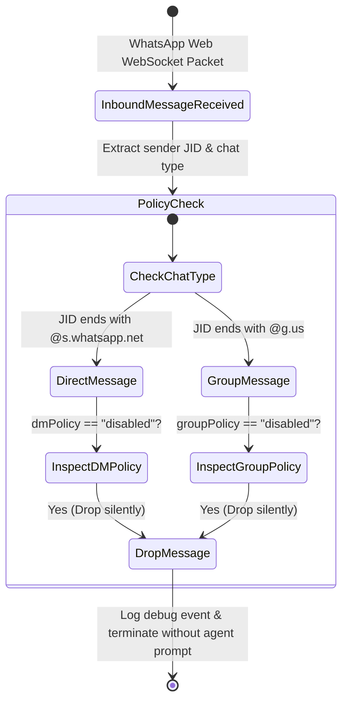
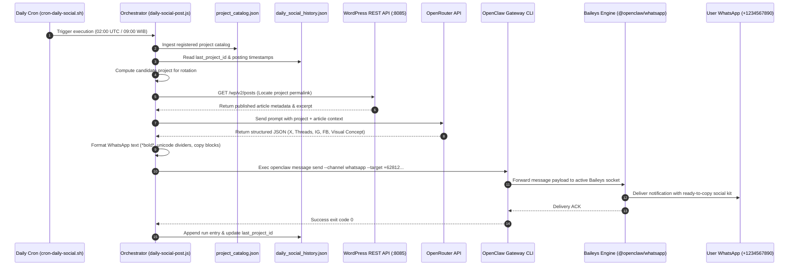

# Architecture Document: OpenClaw WhatsApp API Channel & Daily Social Dispatcher

## 1. System Topology & Process Boundaries

The WhatsApp integration inside OpenClaw acts as an outbound gateway service, using WhatsApp Web's multi-device protocol backed by Baileys. It interfaces with the OpenClaw Core Gateway via internal WebSocket and IPC channels:

```
┌─────────────────────────────────────────────────────────────────────────────────────────────────┐
│ LOCAL HOST (Linux Node: /home/thirzq/.openclaw)                                                 │
│                                                                                                 │
│  ┌────────────────────────────────────────────────────────┐                                     │
│  │ Scheduled Ingestion / CLI Invocation                   │                                     │
│  │                                                        │                                     │
│  │ • cron: 0 2 * * * (09:00 WIB)                          │                                     │
│  │ • scripts/daily-social-post.js                         │                                     │
│  │ • Read: project_catalog.json & articles_log.json       │                                     │
│  │ • State: daily_social_history.json                     │                                     │
│  └───────────────────────────┬────────────────────────────┘                                     │
│                              │                                                                  │
│                              ▼ HTTPS Request                                                    │
│                 ┌───────────────────────────┐                                                   │
│                 │ OpenRouter Inference API  │ (meta-llama/llama-3.3-70b-instruct)               │
│                 └────────────┬──────────────┘                                                   │
│                              │ JSON Response (4 Platform Posts + Visual Concept)                │
│                              ▼                                                                  │
│  ┌────────────────────────────────────────────────────────┐                                     │
│  │ Formatter & Temp Buffer                                │                                     │
│  │ • Formats WhatsApp Markdown (*bold*, bullet lists)     │                                     │
│  │ • Writes to tmp_social_msg_<timestamp>.txt             │                                     │
│  └───────────────────────────┬────────────────────────────┘                                     │
│                              │                                                                  │
│                              ▼ CLI Exec: openclaw message send --channel whatsapp               │
│  ┌────────────────────────────────────────────────────────┐                                     │
│  │ OpenClaw Gateway Process (Node.js :18789)              │                                     │
│  │                                                        │                                     │
│  │ ┌──────────────────────────────────────────────────┐   │                                     │
│  │ │ Channel Manager & Policy Gate                    │   │                                     │
│  │ │ • Inbound Drop: dmPolicy=disabled, group=disabled│   │                                     │
│  │ │ • Outbound Route: @openclaw/whatsapp plugin      │   │                                     │
│  │ └─────────────────────────┬────────────────────────┘   │                                     │
│  │                           ▼                                                                  │
│  │ ┌──────────────────────────────────────────────────┐   │                                     │
│  │ │ @openclaw/whatsapp (Baileys WebSocket Engine)    │   │                                     │
│  │ │ • Noise Key Protocol & Auth Store                │   │                                     │
│  │ │   (~/.openclaw/credentials/whatsapp/)            │   │                                     │
│  │ └─────────────────────────┬────────────────────────┘   │                                     │
│  └───────────────────────────┼────────────────────────────┘                                     │
└──────────────────────────────┼──────────────────────────────────────────────────────────────────┘
                               │ Encrypted TLS WebSocket
                               ▼
                ┌───────────────────────────────┐
                │ WhatsApp Web Multi-Device Net │
                └──────────────┬────────────────┘
                               │ Push Notification
                               ▼
                ┌───────────────────────────────┐
                │ User WhatsApp Device          │
                │ (+1234567890)              │
                └───────────────────────────────┘
```

---

## 2. Inbound & Outbound State Flow

### 2.1 Inbound Message Dropping State Machine
To guarantee complete privacy and zero bot interference in private communications, the OpenClaw Gateway processes incoming WhatsApp packets through a deterministic policy drop gate:



### 2.2 Outbound Daily Social Post Kit Flow



---

## 3. Data Formats & Payloads

### 3.1 Project History Schema (`daily_social_history.json`)
```json
{
  "last_run_timestamp": "2026-10-31T02:00:00.000Z",
  "last_project_id": "uptime-medics",
  "history": [
    {
      "date": "2026-10-31",
      "project_id": "uptime-medics",
      "project_name": "Uptime Medics",
      "title": "High-Performance Distributed Uptime Monitoring in Rust",
      "link": "https://wordpress.nevatal.id/uptime-medics-monitoring/",
      "sent_to": "+1234567890"
    }
  ]
}
```

### 3.2 Formatted WhatsApp Message Contract
```
🚀 *DAILY SOCIAL MEDIA POST KIT*
📅 *Date:* 2026-10-31
🏷️ *Featured Project:* Uptime Medics
🔗 *Live Link:* https://uptime.nevatal.id
📖 *WordPress Article:* https://wordpress.nevatal.id/uptime-medics-monitoring/

━━━━━━━━━━━━━━━━━━━━━━━━━━
🐦 *1. X (TWITTER)* [Tap to Copy]
━━━━━━━━━━━━━━━━━━━━━━━━━━
Enterprise uptime monitors charge $50/mo just for basic HTTP ping checks.

We built Uptime Medics in pure Rust:
• Single binary (<30MB RAM)
• Zero-signup community monitoring
• Multi-hop SSRF & DNS rebinding defense
• Token bucket rate limiting

Explore the live tool: https://uptime.nevatal.id
#RustLang #DevOps

━━━━━━━━━━━━━━━━━━━━━━━━━━
🧵 *2. THREADS* [Tap to Copy]
━━━━━━━━━━━━━━━━━━━━━━━━━━
...

━━━━━━━━━━━━━━━━━━━━━━━━━━
📸 *3. INSTAGRAM* [Tap to Copy]
━━━━━━━━━━━━━━━━━━━━━━━━━━
...
💡 *Visual Concept Suggestion:*
...

━━━━━━━━━━━━━━━━━━━━━━━━━━
📘 *4. FACEBOOK PAGE* [Tap to Copy]
━━━━━━━━━━━━━━━━━━━━━━━━━━
...

━━━━━━━━━━━━━━━━━━━━━━━━━━
✨ *Daily post kit prepared!* Copy and publish each platform whenever you're ready.
```

---

## 4. Security, Credentials & Isolation

1. **Credential Store:** `~/.openclaw/credentials/whatsapp/` contains the Baileys multi-device authentication state:
   - `creds.json`: Noise protocol cryptographic keys, identity keypairs, signed prekeys.
   - Filesystem permissions: `0700` directory access, restricted to local user `thirzq`.
2. **Rate Limiting & Anti-Ban Safeguards:**
   - Single message batch transmission per day.
   - Message transmission occurs over authenticated persistent WebSocket with backoff retries.
   - No unsolicited marketing or mass recipient broadcast lists.
