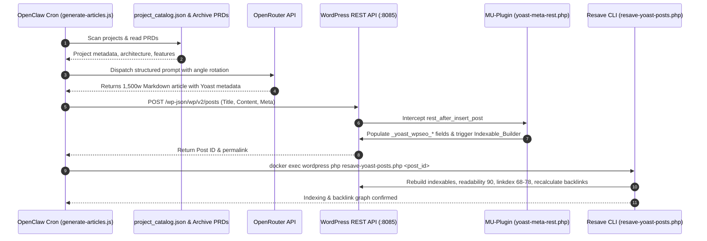
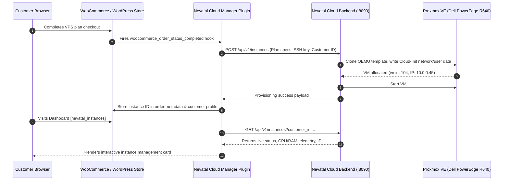

# Architecture Document: WordPress Automation & Content Engine

## 1. System Topology & Cross-Device Infrastructure

The WordPress Automation platform operates across two physical nodes: the **Local Development & Agent Node** (where OpenClaw, containerized WordPress, and the SEO engine run) and the **Remote Homelab Node** (`100.86.61.70`, where Nevatal Cloud and the Proxmox VE hypervisor operate):

```
┌─────────────────────────────────────────────────────────────────────────────────────────────────┐
│ LOCAL NODE (This Device: /home/thirzq/.openclaw)                                                │
│                                                                                                 │
│  ┌────────────────────────────────────────┐          ┌──────────────────────────────────────┐   │
│  │ OpenClaw Agent & CLI                   │          │ WordPress Docker Stack               │   │
│  │                                        │          │                                      │   │
│  │ • Catalog Discovery:                   │  REST    │ • Nginx Reverse Proxy (Port 8085)    │   │
│  │   project_catalog.json + archive/*.md  ├─────────►│ • WordPress Core Container (PHP-FPM)│   │
│  │ • Article Generator:                   │ BasicAuth│   - mu-plugins/yoast-meta-rest.php   │   │
│  │   generate-articles.js                 │          │   - scripts/resave-yoast-posts.php   │   │
│  │ • WP-CLI Script: wp-cli.js             │          │ • MySQL 8.0 Database (wordpress-db)  │   │
│  └───────────────────┬────────────────────┘          └──────────────────┬───────────────────┘   │
│                      │                                                  │                       │
│                      │ OpenRouter API                                   │ HTTPS / Public        │
│                      ▼                                                  ▼                       │
│             ┌─────────────────┐                             ┌───────────────────────┐           │
│             │   OpenRouter    │                             │ wordpress.nevatal.id  │           │
│             │ LLM Ingestion   │                             └───────────────────────┘           │
│             └─────────────────┘                                                                 │
└───────────────────────────────────────────────┬─────────────────────────────────────────────────┘
                                                │ Tailscale / Encrypted SSH (100.86.61.70)
                                                ▼
┌─────────────────────────────────────────────────────────────────────────────────────────────────┐
│ REMOTE HOMELAB NODE (homelab: 100.86.61.70)                                                    │
│                                                                                                 │
│  ┌────────────────────────────────────────┐          ┌──────────────────────────────────────┐   │
│  │ Nevatal Cloud VPS Manager Plugin       │          │ Nevatal Cloud Infrastructure         │   │
│  │ (nevatal-cloud-manager)                │          │                                      │   │
│  │ • WooCommerce Checkout Hook            ├─────────►│ • Nevatal Go API Backend (Port 8090) │   │
│  │ • Shortcode: [nevatal_instances]       │ Bearer   │ • React Cloud Console (Port 3080)    │   │
│  │ • Hypervisor Admin Panel               │ Auth     │ • PostgreSQL 16 & Redis 7            │   │
│  └────────────────────────────────────────┘          └──────────────────┬───────────────────┘   │
│                                                                         │ QEMU / Cloud-Init     │
│                                                                         ▼                       │
│                                                              ┌──────────────────────┐           │
│                                                              │ Proxmox VE Cluster   │           │
│                                                              │ Dell PowerEdge R640  │           │
│                                                              └──────────────────────┘           │
└─────────────────────────────────────────────────────────────────────────────────────────────────┘
```

---

## 2. Component Pipeline & Data Flow

### 2.1 Automated Article Generation Flow



### 2.2 Cross-Device WooCommerce to Proxmox Provisioning Flow



---

## 3. Database Schema & Yoast SEO Indexable Structure

### 3.1 WordPress Post Meta Schema
When an article is created, the system writes the following metadata entries to `wp_postmeta`:
* `_yoast_wpseo_focuskw`: Extracted focus keyphrase (e.g., "Uptime Medics distributed monitoring architecture").
* `_yoast_wpseo_title`: SEO Title formatted with target branding (`%%title%% %%page%% %%sep%% Nevatal Engineering`).
* `_yoast_wpseo_metadesc`: Curated 150–155 character excerpt summarizing the article for Google SERP cards.
* `_yoast_wpseo_estimated_reading_time_minutes`: Computed as $\lceil \text{word\_count} / 220 \rceil$.
* `_yoast_wpseo_content_score`: Target readability score set to `90`.
* `_yoast_wpseo_linkdex`: Computed keyword density & SEO score set to target range `68–78`.
* `_yoast_wpseo_primary_category`: Assigned primary category ID.

### 3.2 Yoast Indexable Tables
The resave script synchronizes two internal Yoast tables:
1. **`wp_yoast_indexable`**:
   - `object_id`: Post ID
   - `object_type`: `post`
   - `object_sub_type`: `post`
   - `primary_focus_keyword`: Target keyword
   - `readability_score`: 90
   - `linkdex`: Calculated score
   - `incoming_link_count`: Recomputed sum from `wp_yoast_seo_links`
2. **`wp_yoast_seo_links`**:
   - Stores all source/target hyperlinks found inside `post_content` to dynamically maintain the internal backlink graph.

---

## 4. Operational Commands & Maintenance

```bash
# 1. Generate articles for projects missing documentation:
npm run --prefix /home/thirzq/.openclaw/workspace/skills/wordpress generate

# 2. Resave Yoast SEO for single post:
docker exec wordpress php -d memory_limit=512M /var/www/html/resave-yoast-posts.php <post_id>

# 3. Full batch Yoast SEO resynchronization:
npm run --prefix /home/thirzq/.openclaw/workspace/skills/wordpress resave-yoast

# 4. Check Proxmox VPS plugin connection on homelab:
ssh thirzq@100.86.61.70 "curl -s http://localhost:8090/health"
```
